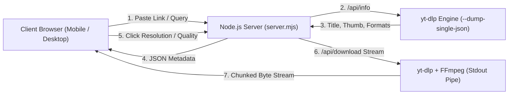

# ⚡ OMNI — Universal 3D Vinyl Media Downloader

An interactive, high-performance multi-platform video and audio downloader web application inspired by luxury cinematic vinyl carousels. Powered by **Three.js (WebGL)**, **yt-dlp**, and a native **Node.js** streaming server.


---

## 🌟 Highlights & Capabilities

- **Universal Auto-Detection**: Paste any video or audio link from any supported platform — OMNI automatically parses the domain and navigates the 3D carousel directly to the matching platform record.
- **12 Dedicated Platform Discs**:
  1. 🌐 **Universal Auto-Detect** (Iridescent holographic aura + OMNI bolt)
  2. 🔴 **YouTube** (Crimson gloss + 4K / 1080p / 60fps MP4 & 320k MP3)
  3. 📸 **Instagram** (Sunset magenta-orange gradient + Reels & Stories)
  4. ☁️ **Terabox** (Cyber navy & electric cyan + Cloud video extractor)
  5. 🎵 **TikTok** (Matte noir & chromatic aberration note + HD watermark-free)
  6. 🔵 **Facebook** (Royal blue watch + Reels & Public video streams)
  7. ✖️ **Twitter / X** (Monochrome titanium + Micro-video grabber)
  8. 🟢 **Spotify** (Neon mint soundwaves + High-bitrate audio metadata)
  9. 🟠 **SoundCloud** (Sunburst orange + 320kbps MP3 / FLAC)
  10. 🤖 **Reddit** (Orange-red Snoo badge + v.redd.it audio-muxed clips)
  11. 📌 **Pinterest** (Scarlet pin + Idea pins & 1080p clips)
  12. 🟣 **Twitch** (Purple broadcast tower + VODs & Live clips)
- **Direct Real-Time Streaming**: Downloads are streamed on-the-fly directly to the browser via chunked HTTP transfer encoding (`Content-Disposition: attachment`), eliminating the need for bulky server-side temp file caching.
- **Mobile-First Responsive Design**:
  - Dynamic aspect-ratio camera framing in Three.js (steps camera back on portrait viewports so records never clip).
  - Native mobile bottom-sheet modal for smooth scrolling and quality selection.
  - Prevents iOS Safari auto-zoom with normalized `16px` inputs.
  - Smooth touch interactions with `touch-action: none` on the WebGL canvas.

---

## 🏗️ Architecture



---

## 🚀 Running Locally

### Prerequisites
1. **Node.js** (v18.0.0 or higher)
2. **Python 3** (3.8+)
3. **FFmpeg** (installed and available in system `PATH`)
4. **yt-dlp** (installed and available in system `PATH`):
   ```bash
   # Windows (via winget or pip)
   winget install yt-dlp
   # macOS (via brew)
   brew install yt-dlp ffmpeg
   # Linux (Debian/Ubuntu)
   sudo apt install ffmpeg && pip3 install yt-dlp
   ```

### Start the Server
```bash
# Clone or navigate to the directory
cd a24-showcase

# Run the production server
npm start

# Or run in development watch mode
npm run dev
```

The application will be live at:
```
http://localhost:3000
```

---

## 🐳 Docker Deployment

A production-ready `Dockerfile` based on `node:20-alpine` with Python 3, FFmpeg, and the latest `yt-dlp` binary is included.

### Build and Run:
```bash
# Build the Docker image
docker build -t omni-downloader .

# Run the container exposing port 3000
docker run -d -p 3000:3000 --name omni omni-downloader
```

Open `http://localhost:3000` in your browser.

---

## ☁️ 1-Click Cloud Deployment

### 1. Railway (`railway.app`)
1. Create a new project on Railway.
2. Select **Deploy from GitHub repo** and point it to your repository.
3. Railway automatically detects the `Dockerfile` and builds the Alpine image with FFmpeg and yt-dlp.
4. Set environment variable `PORT=3000` (optional; defaults to assigned port).
5. Generate a public domain under **Networking**.

### 2. Render (`render.com`)
1. Create a **New Web Service**.
2. Connect your Git repository.
3. Select **Docker** as the runtime environment.
4. Set Plan to Free or Starter.
5. Click **Deploy Web Service**.

### 3. Fly.io (`fly.io`)
```bash
fly launch
fly deploy
```

---

## 📱 Mobile Optimizations

| Feature | Desktop Implementation | Mobile Implementation (<768px) |
| :--- | :--- | :--- |
| **Viewport Framing** | Camera `z = 4.4`, scale `1.0` | Dynamic camera `z = 5.7`, scale `0.92` (no edge clipping) |
| **Download Modal** | Centered frosted glass card | Native slide-up bottom sheet (`85vh` scrollable) |
| **Specifications Bar** | Wide horizontal floating card | Compact 2×2 blurred grid above disc |
| **URL Input Bar** | Floating centered dock (`bottom: 6.8rem`) | Fixed bottom dock (`bottom: 1.2rem`) with `16px` font (no iOS zoom) |
| **Navigation** | Full brand pill with sound toggle | Streamlined minimalist pill |

---

## 🛡️ License

MIT License. Created with precision for high-speed media extraction and aesthetic WebGL interactions.
